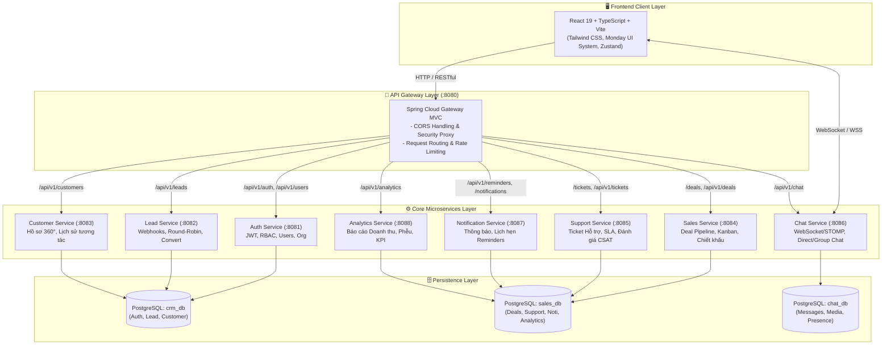
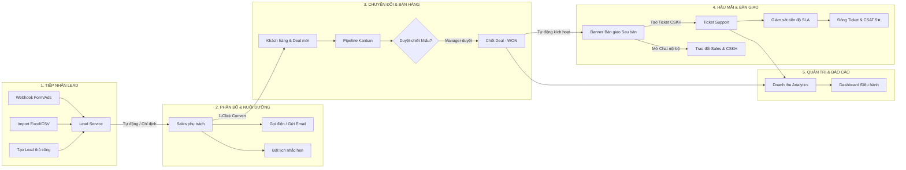

# 🚀 STAPlus CRM - Nền Tảng Quản Trị Khách Hàng Đa Kênh Theo Kiến Trúc Microservices (SOA)

<p align="center">
  
  
  
  
  
  
</p>

---

## 📖 1. Giới Thiệu Dự Án (Project Overview)

**STAPlus CRM** là giải pháp phần mềm Quản trị Quan hệ Khách hàng (Customer Relationship Management) toàn diện được thiết kế và xây dựng theo chuẩn **Kiến trúc Hướng Dịch vụ (Service-Oriented Architecture - SOA / Microservices)**. 

Hệ thống giải quyết triệt để các bài toán phân mảnh dữ liệu, đứt gãy luồng cộng tác và thiếu kiểm soát tiến độ trong doanh nghiệp hiện đại bằng cách hợp nhất 5 giai đoạn cốt lõi của vòng đời khách hàng:
1. **Thu thập Lead đa kênh** (Form Website, Webhook MXH, Ads, Nhập file Excel).
2. **Phân bổ & Nuôi dưỡng Lead** (Phân quyền scoped cho Sales, nhắc hẹn Follow-up).
3. **Quản lý Bán hàng & Chốt Deal** (1-click Convert Lead ➔ Customer & Deal, Pipeline Kanban, Duyệt chiết khấu).
4. **Dịch vụ CSKH & Bàn giao sau bán** (Tự động kích hoạt Ticket khi Deal Won, Cam kết SLA đếm ngược, Đánh giá CSAT 5 sao).
5. **Cộng tác & Ra quyết định** (Trò chuyện nội bộ Realtime WebSocket, Dashboard theo từng vai trò, Báo cáo Phân tích Analytics).

---

## 🏗️ 2. Sơ Đồ Kiến Trúc Hệ Thống (System Architecture)

Hệ thống được module hóa thành **9 Microservices độc lập**, giao tiếp thông qua **API Gateway tập trung** và cơ chế liên lạc nội bộ an toàn (JWT Stateless + Internal Service Keys):



---

## 🔄 3. Sơ Đồ Luồng Vận Hành Toàn Diện (Operational Flowchart)

STAPlus CRM vận hành khép kín qua 5 giai đoạn liên kết chặt chẽ:



---

## 👥 4. Phân Quyền Vai Trò & Giao Diện Chuyên Biệt (Role-Based Workspaces)

Khác với các CRM thông thường hiển thị chung một màn hình cho mọi người dùng, STAPlus CRM xây dựng **không gian làm việc chuyên biệt (Tailored Workspaces)** được bảo vệ nhiều tầng từ Backend đến RouteGuard:

| Tiêu chí | 👑 Quản trị viên (Admin) / Quản lý (Manager) | 💼 Nhân viên Kinh doanh (Sales) | 🎧 Nhân viên Hỗ trợ (Support) |
| :--- | :--- | :--- | :--- |
| **Giao diện Trang chủ (`/dashboard`)** | **Tổng quan Doanh nghiệp**: Báo cáo doanh thu toàn công ty, phễu chuyển đổi, xếp hạng Sales, top khách hàng VIP, cảnh báo tồn đọng. | **Bàn làm việc Sales**: Chỉ hiển thị khách hàng phụ trách, lead đang chăm sóc, deal cá nhân, doanh số Won thực thu, lịch nhắc việc hôm nay. | **Bàn làm việc CSKH**: Hàng đợi ticket cần xử lý, ticket khẩn cấp, khách hàng đã & đang hỗ trợ, tỷ lệ hoàn thành SLA, điểm CSAT. |
| **Phạm vi dữ liệu Khách hàng & Lead** | Xem toàn bộ dữ liệu tổ chức; có quyền phân bổ, import excel, cấu hình webhook. | Chỉ xem Lead & Khách hàng được phân công cho chính tài khoản cá nhân. | Chỉ tra cứu khách hàng có phát sinh yêu cầu hỗ trợ hoặc cần phối hợp. |
| **Tính năng Thêm Lead** | Đầy đủ nút: *Phân bổ tự động*, *Kênh thu thập*, *Nhập Excel/CSV*, *+ Thêm Lead*. | Chỉ có nút **`+ Thêm Lead`** (Lead tạo ra tự động gán cho chính Sales phụ trách, không được phân bổ chéo). | Không có quyền tác nghiệp Lead. |
| **Quyền truy cập Phân tích (`/analytics`)** | Toàn quyền xem báo cáo phân tích chiến lược doanh nghiệp. | **Ẩn hoàn toàn** khỏi Sidebar và chặn truy cập bằng `RoleGuard`. | **Ẩn hoàn toàn** khỏi Sidebar và chặn truy cập bằng `RoleGuard`. |
| **Tác nghiệp Bán hàng & Chốt Deal** | Phê duyệt yêu cầu giảm giá / chiết khấu từ Sales. | Tạo deal, kéo thả Kanban, xin duyệt chiết khấu, chốt deal Won. | Nhận bàn giao kỹ thuật/dịch vụ khi Deal chuyển sang trạng thái Won. |
| **Tác nghiệp CSKH & CSAT** | Theo dõi tỷ lệ vi phạm SLA và điểm đánh giá CSAT trung bình. | Xem được ticket liên quan của khách hàng trong hồ sơ Customer 360°. | Tiếp nhận ticket, cập nhật trạng thái, đếm ngược SLA, thu thập khảo sát CSAT. |

---

## 🛠️ 5. Công Nghệ & Kỹ Thuật Nổi Bật (Tech Stack & Highlights)

### Backend (Microservices)
- **Framework**: Java 17, Spring Boot 3.3.x, Spring Cloud Gateway MVC.
- **Bảo mật**: Spring Security, JWT (Access Token + Refresh Token cơ chế xoay vòng), BCrypt Password Hashing, RBAC Filter.
- **Giao tiếp Realtime**: WebSocket với giao thức STOMP, SockJS fallback, cơ chế Chat Presence (Online/Offline tracking).
- **Cơ sở dữ liệu**: PostgreSQL với kiến trúc Database-per-Service (3 databases tách biệt: `crm_db`, `sales_db`, `chat_db`), kết hợp Spring Data JPA & Hibernate.
- **Tính năng nổi bật**:
  - Webhook Receiver tự động chuẩn hóa Lead từ nhiều nguồn (Website, Facebook, Zalo, Google Ads).
  - Thuật toán phân bổ Lead tự động (Round-robin cân bằng tải công việc).
  - Quy trình 1-click Convert Lead thành Khách hàng & Cơ hội kinh doanh.
  - Tính năng đếm ngược hạn chót SLA và cảnh báo quá hạn cho đội ngũ Support.
  - Khảo sát độ hài lòng khách hàng CSAT (1 - 5 sao) lưu trữ bền vững.

### Frontend (Modern SPA)
- **Core**: React 19, TypeScript, Vite Bundler (biên dịch siêu tốc < 1 giây).
- **Thiết kế & Giao diện**: 
  - Hệ thống Design System lấy cảm hứng từ **Monday.com CRM** (`monday-inspired-crm.css`).
  - Hỗ trợ đầy đủ **Chế độ Sáng / Tối (Dark / Light Mode)** linh hoạt theo người dùng.
  - Trang Đăng ký / Đăng nhập luôn giữ chuẩn mực Light Mode chuyên nghiệp.
- **Quản lý Trạng thái (State Management)**: Zustand (chia nhỏ `authStore`, `chatStore`, `themeStore`, `settingsStore`).
- **Thư viện Giao diện**: Tailwind CSS v4, Material-UI (MUI components), Lucide Icons.
- **Kiểm thử Tự động E2E**: Playwright Test Suite kiểm thử luồng thực tế và xuất hình ảnh bằng chứng nghiệm thu.

---

## 🚀 6. Hướng Dẫn Cài Đặt & Khởi Chạy (Quick Start)

### Yêu cầu tiên quyết
- **JDK 17** trở lên.
- **Node.js 20+** & **npm 10+**.
- **PostgreSQL 15+** đang chạy trên cổng mặc định `5432`.

---

### Bước 1: Chuẩn bị Cơ sở dữ liệu (PostgreSQL)
Tạo 3 database trong PostgreSQL:
```sql
CREATE DATABASE crm_db;
CREATE DATABASE sales_db;
CREATE DATABASE chat_db;
```

### Bước 2: Cấu hình biến môi trường
Sao chép file mẫu và cấu hình thông số kết nối:
```bash
cp .env.example .env
```
*(Chỉnh sửa username/password database trong `.env` nếu cần thiết)*

---

### Bước 3: Khởi động toàn bộ Backend Microservices
Dự án đã tích hợp sẵn script quản lý tự động:

```bash
# Cấp quyền thực thi (chỉ cần chạy lần đầu)
chmod +x start-backend.sh stop-backend.sh status.sh

# Khởi động toàn bộ 9 microservices
./start-backend.sh
```

Kiểm tra trạng thái các service:
```bash
./status.sh
```
Kết quả hiển thị:
```text
====================================================================
           📊 BẢNG TRẠNG THÁI HỆ THỐNG CRM STAPLUS                
====================================================================
Dịch vụ                     Cổng       Trạng thái     PID            
--------------------------------------------------------------------
PostgreSQL (Database)       5432       RUNNING        ...
API Gateway (Entry)         8080       RUNNING        ...
Auth Service                8081       RUNNING        ...
Lead Service                8082       RUNNING        ...
Customer Service            8083       RUNNING        ...
Sales Service               8084       RUNNING        ...
Support Service             8085       RUNNING        ...
Chat Service (WS)           8086       RUNNING        ...
Notification Service        8087       RUNNING        ...
Analytics Service           8088       RUNNING        ...
--------------------------------------------------------------------
Frontend (Vite)             5173       RUNNING        ...
====================================================================
```

---

### Bước 4: Khởi động Frontend
Mở một terminal mới:
```bash
cd frontend
npm install
npm run dev
```

Truy cập ứng dụng tại: 👉 **`http://localhost:5173`**

---

## 🔑 7. Tài Khoản Trải Nghiệm Mẫu (Demo Accounts)

Hệ thống đã được nạp sẵn dữ liệu mẫu đại diện cho 3 vai trò chính để phục vụ demo và đánh giá:

| Vai trò | Tên đăng nhập (Username) | Mật khẩu (Password) | Chức năng trải nghiệm chính |
| :--- | :--- | :--- | :--- |
| **Quản trị viên (Admin)** | `admin` | `Admin@123456` | Dashboard toàn công ty, Phân tích doanh thu, Duyệt chiết khấu, Phân bổ Lead, Quản lý người dùng. |
| **Nhân viên Kinh doanh (Sales)** | `sales` | `Sales@123456` | Bàn làm việc Sales, Lead/Khách hàng cá nhân, Tạo deal, Kéo thả Kanban, Chốt deal Won, Bàn giao sau bán. |
| **Nhân viên CSKH (Support)** | `support` | `Support@123456` | Bàn làm việc CSKH, Tiếp nhận Ticket hỗ trợ, Cảnh báo hạn chót SLA, Khảo sát độ hài lòng CSAT 5 sao. |

---

## 📁 8. Cấu Trúc Thư Mục Dự Án (Project Structure)

```text
CRM-SOA/
├── backend/
│   ├── api-gateway/          # Cổng API Gateway định tuyến tập trung (:8080)
│   ├── auth-service/         # Dịch vụ Xác thực & Quản lý Người dùng (:8081)
│   ├── lead-service/         # Dịch vụ Thu thập, Phân bổ & Chuyển đổi Lead (:8082)
│   ├── customer-service/     # Dịch vụ Quản lý Khách hàng & Hồ sơ 360° (:8083)
│   ├── sales-service/        # Dịch vụ Quản lý Cơ hội & Pipeline Bán hàng (:8084)
│   ├── support-service/      # Dịch vụ Ticket Hỗ trợ, SLA & Đánh giá CSAT (:8085)
│   ├── chat-service/         # Dịch vụ Trò chuyện nội bộ WebSocket (:8086)
│   ├── notification-service/ # Dịch vụ Thông báo & Lịch nhắc hẹn (:8087)
│   └── analytics-service/    # Dịch vụ Báo cáo & Phân tích Doanh thu (:8088)
├── frontend/
│   ├── src/
│   │   ├── components/       # Các UI Component theo module (Dashboard, Leads, Deals...)
│   │   │   └── dashboard/    # Giao diện Trang chủ riêng cho Admin, Sales, Support
│   │   ├── pages/            # Màn hình chức năng (Auth, Leads, Customers, Deals, Chat...)
│   │   ├── routes/           # Hệ thống định tuyến & RoleGuard bảo vệ theo vai trò
│   │   ├── services/         # Tầng kết nối API Axios tới từng Microservice
│   │   ├── stores/           # Quản lý Global State bằng Zustand
│   │   └── styles/           # Design System Monday.com CRM
│   └── package.json
├── start-backend.sh          # Script khởi động tự động tất cả các service
├── stop-backend.sh           # Script dừng các service an toàn
├── status.sh                 # Script kiểm tra bảng trạng thái cổng & tiến trình
└── README.md                 # Tài liệu hướng dẫn tổng quan dự án
```

---

## 🔮 9. Định Hướng Phát Triển Tiếp Theo (Future Roadmap)

- 🤖 **Tích hợp Trí tuệ Nhân tạo (AI Engine)**:
  - Dự đoán khả năng chốt Deal thành công dựa trên lịch sử tương tác (Deal Scoring).
  - Gợi ý sản phẩm phù hợp cho từng tệp khách hàng (Recommendation System).
  - Trợ lý ảo AI tóm tắt nội dung cuộc gọi/email và tự động tạo Ticket hỗ trợ.
- 📱 **Hỗ trợ Đa nền tảng**: Xây dựng phiên bản Mobile App (React Native / Flutter) dành riêng cho nhân viên Sales thị trường.
- 💬 **Tích hợp Đa kênh mở rộng**: Kết nối trực tiếp Zalo ZNS, SMS Brandname, và tổng đài VoIP ảo (Call Center).

---

<p align="center">
  <b>STAPlus CRM</b> • <i>Kiến tạo giá trị vững bền cho doanh nghiệp qua từng điểm chạm khách hàng.</i><br/>
  © 2026 STAPlus CRM Team. All rights reserved.
</p>
